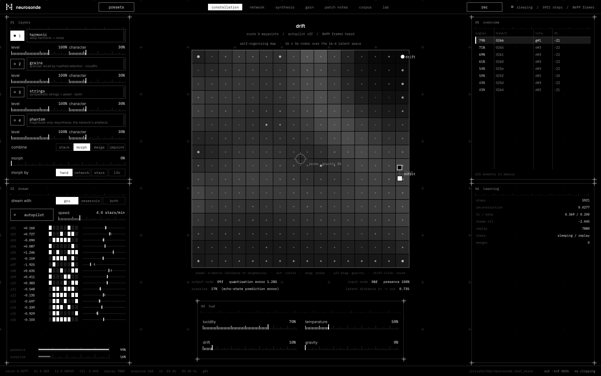
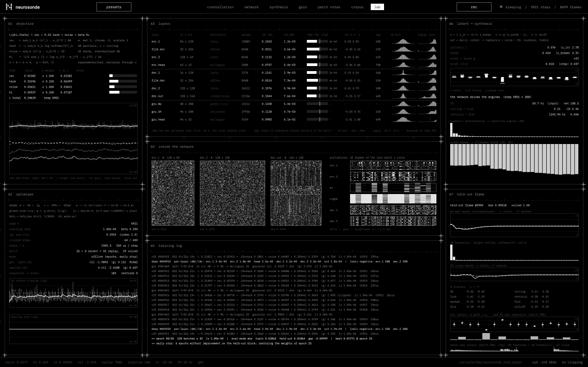
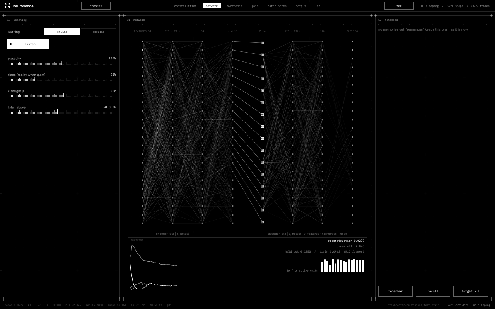
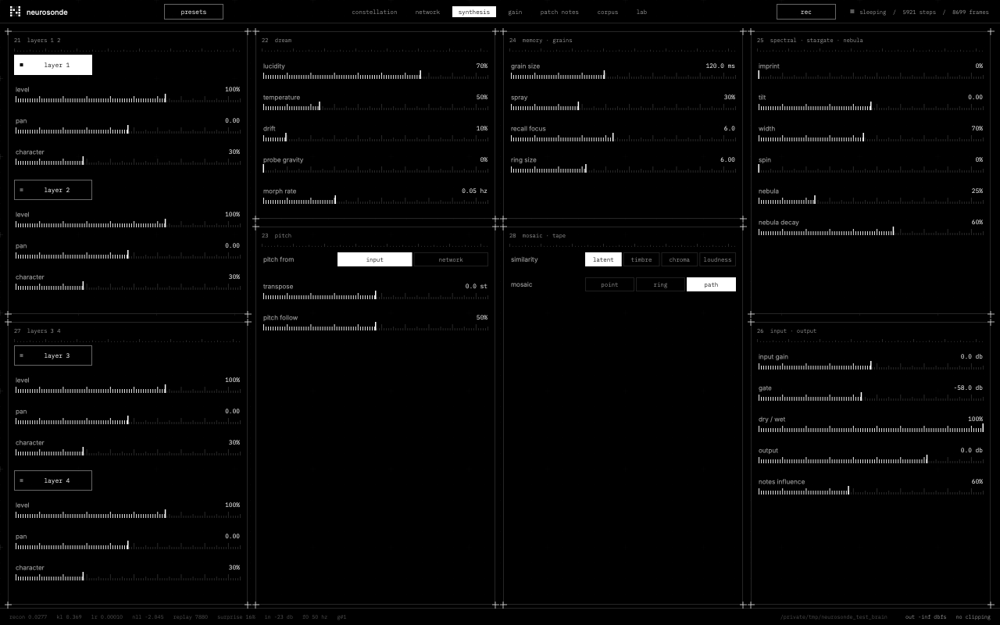
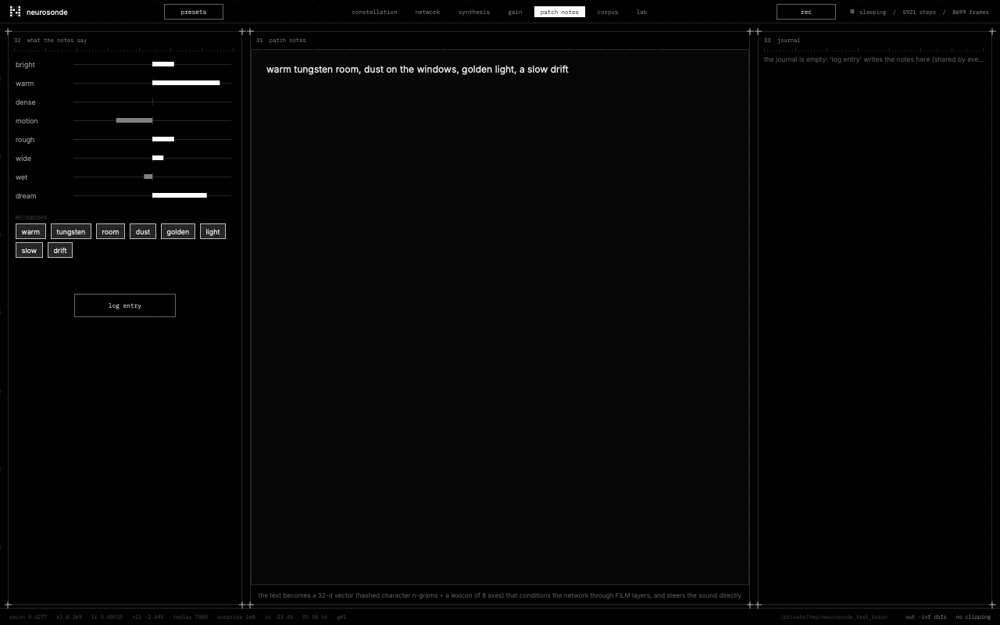
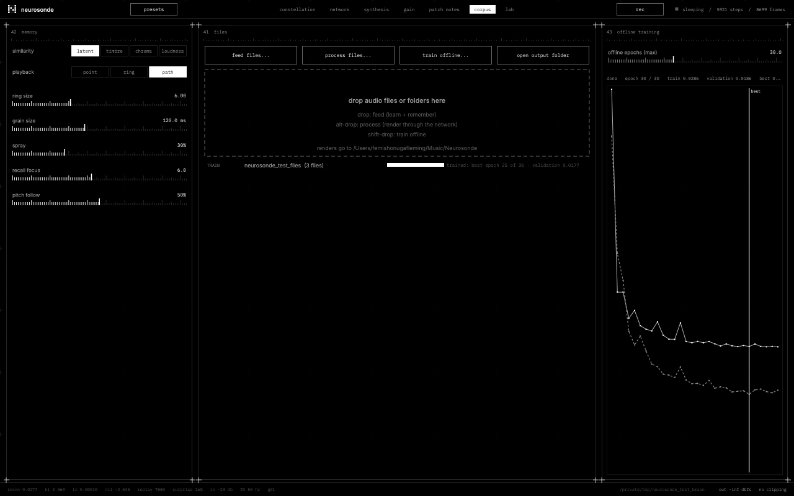
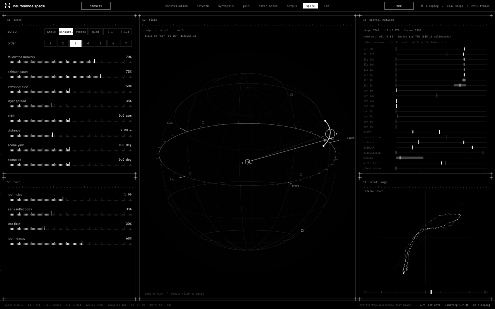
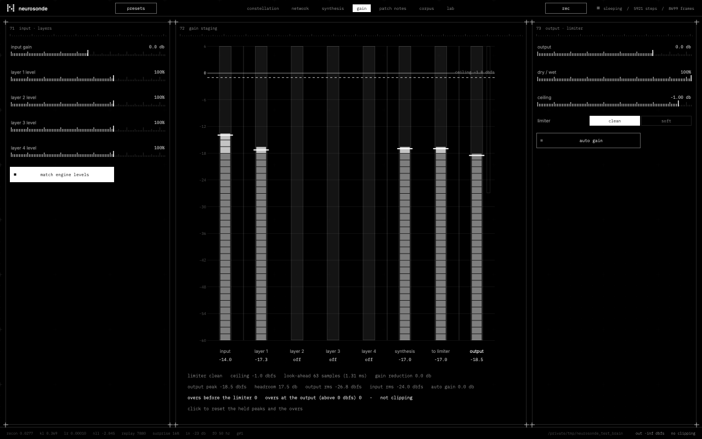

# neurosonde

An **audio effect** for macOS (AU, VST3, app), Windows (VST3, app) and Linux (VST3, LV2, app): it goes on an audio
track, learns from the audio that passes through it (live, or from files), and resynthesises generative sound from
what it has learned. No MIDI: audio in, audio out. Plus **neurosonde space**, the same instrument rendered into
space, placed by a network that learns the stereo image of what it hears.

**New in 1.1**
- **seven more synthesis engines**, each a whole model: modal (40 resonant modes, string to bell), membrane (a struck
  2-D drum skin), fm (four operators), bowed (a bowed waveguide string), scanned (a ring of masses pushed by the
  spectrum), pulsar (pulsarets at the formants) and swarm (partials flocking to the peaks). Eighteen in all.
- **gain staging**: a new gain page with a meter at every stage, a look-ahead limiter at a ceiling (no sample
  leaves above it), auto gain, and every engine level-matched to the loudness the network decodes. The footer of
  every page shows the output peak and whether anything clipped.
- **Windows and Linux** builds, with the same sound as the Mac (the FFT and the matrix products are held to Apple's
  Accelerate by tests), and a Homebrew cask.
- fixes: the harmonic engine's noise follows how loud the noise really is (tonal sounds were buried in hiss); the
  phantom engine no longer starts as a click train; the bowed string plays its highest notes; the voice engine sat
  far under the others; brain files on Windows; the plug-in loads on macOS 12 again.

## what it really does
- **analysis** every 10 ms: 64 log-mel bands, chroma, pitch (YIN), voicing, loudness, centroid, spread, flatness,
  flux, rolloff; plus DDSP-style targets (harmonic distribution at k·f0, 32-band noise residual).
- **the brain** (one per process, shared by every instance and the app; other processes merge through
  `~/Library/Application Support/Neurosonde/brain.nsb` with federated delta averaging under a file lock):
  - a conditional **VAE** (84 → 128 → 64 → z16 → 128 → 128 → 164) with **FiLM** layers conditioned on the patch notes,
  - a **GRU** that predicts the next latent (Gaussian, sampled at a temperature): it dreams forward,
  - an **echo state network** with an RLS readout (a second dreamer),
  - a 16 × 16 **self-organising map**: the constellation,
  - modern-**Hopfield** recall over remembered moments (grains, mosaic, tape),
  - online Adam with a learning-rate floor, gradient clipping, running standardisation, a **replay reservoir**
    against catastrophic forgetting, KL warm-up, NaN rollback, and **sleep** (replay consolidation when quiet),
  - **evaluation**: every 10th frame is held out (never trained on). Every 200 steps the eval-mode reconstruction
    on training and held-out frames is plotted side by side (generalisation, not just fit), with the **active latent
    units** (Cov_x E_q[z_u] > 0.01, Burda et al. 2016: the posterior-collapse check) and, for the spatial network, the
    held-out NLL and the **coverage** of its ±1σ interval (68% when calibrated; tested ≈71%),
  - **memories**: named snapshots to go back to (Empty Set built tracks from earlier, rougher stages).
- **patch notes**: hashed character n-grams (fastText-style, random projection) + 8 lexicon axes
  (bright warm dense motion rough wide wet dream, with negation) → a 32-d vector that conditions the network, names
  the stars, and steers the sound directly. The journal is shared by every instance and the app.
- **synthesis**: four layers, each one of 18 engines, all driven by what the network decodes every 10 ms (the
  spectral envelope, the harmonic distribution, the noise bands, pitch, loudness, brightness, noisiness, onsets and
  the latent itself). `character` is each engine's own extra dimension.

  | engine | what it is | character |
  |---|---|---|
  | harmonic | DDSP: 48 harmonics at the decoded distribution + 32 filtered noise bands (Engel et al. 2020) | more noise |
  | phantom | magnitude-only inverse STFT, phase propagated (imprintable on the live input) | phase scatter |
  | partials | 32 additive peaks: the envelope's peaks + a stretched harmonic series | inharmonicity |
  | grains | granular recall of remembered moments by modern-Hopfield attention (after Cloudfin) | density |
  | mosaic | concatenative point / ring / path (after Coalescence) | unit length |
  | ear tones | difference-tone primaries: the ear makes the pitch (after Oneirophone) | primaries' region |
  | strings | 24 sympathetic Karplus–Strong strings with a jawari bridge (after Tantri) | buzz |
  | voice | glottal source through five formants found in the envelope (after Spreekbuis) | formant shift |
  | gendy | Xenakis' dynamic stochastic synthesis | roughness |
  | table | a wavetable rebuilt each hop from the decoded harmonics, wavefolded (after disting EX) | fold |
  | tape | skipping micro-loops and dust (after openprocess / Oval) | skipping |
  | **modal** (1.1) | 40 resonant modes (decaying phasors) at the envelope's peaks + a partial series, struck on onsets, stirred by the noise; higher modes die faster (after Rings) | string → bell (free-bar ratios), longer ring |
  | **membrane** (1.1) | a 2-D finite-difference wave equation on a 14 × 14 skin (after Bilbao), run at the rate that tunes it to the decoded pitch; tension modulation bends the pitch on hard hits; struck where the latent says, two pickups | sustain |
  | **fm** (1.1) | four operators (Chowning): modulator ratios = the strongest decoded harmonics, indices from brightness and noisiness, held under Carson's rule | stack → two pairs, feedback |
  | **bowed** (1.1) | a bowed string: two waveguides joined by a friction table (McIntyre, Schumacher & Woodhouse; Smith), three body resonances; bow speed = loudness, position = the latent | bow pressure (scratch) |
  | **scanned** (1.1) | scanned synthesis (Verplank, Mathews & Shaw): a ring of 64 masses on springs, each pushed by one mel band, moving at 1 kHz; its shape read as a band-limited wavetable | looser springs, more motion |
  | **pulsar** (1.1) | pulsar synthesis (Roads): Hann-windowed pulsarets at the two strongest formants, one per period; noisiness masks pulsars at random | shorter duty, wider formants |
  | **swarm** (1.1) | 48 partials as boids in log-frequency (Reynolds; Blackwell): drawn up the envelope's slope, kept apart, aligned | turbulence |

  Layers combine by **stack**, **morph** (by hand, network, stars or lfo), **merge** (spectral log-magnitude
  interpolation) or **imprint** (one layer's envelope on another). Then stargate (stereo field) and nebula (FDN
  reverb).
- **gain staging** (1.1): every layer is level-matched to the loudness the network decodes (over about 300 ms, only
  while there is sound to match, never boosting near-silence; −24 to +18 dB; *match engine levels*, on by default), so
  any engine sits where the input does and follows its dynamics. Then the output gain (and optional **auto gain**,
  which brings the synthesis to the input's loudness over a few seconds, ±24 dB), the dry / wet mix, and a
  **look-ahead limiter** at the **ceiling** (−12 to 0 dBFS, default −1): for every sample the gain that keeps the
  loudest channel under the ceiling, a minimum over the 1.3 ms look-ahead, an 80 ms release and a moving average over
  the same window, applied to the delayed signal — no sample leaves above the ceiling, and the gain never steps.
  *Clean* is transparent (bit-exact below the ceiling); *soft* saturates into the ceiling first. It can't be turned
  off. Its 1.3 ms is reported to the host as latency. In neurosonde space it is linked across every output channel.
- **files**: drop to feed (learn + remember), alt-drop to process (render through the network → ~/Music/Neurosonde),
  shift-drop (or "train offline...") to train offline.
- **learning: online or offline**.
  - *online* (default): it learns continuously from what it hears, as above. In a DAW bounce (non-realtime) it
    waits for the brain to take every frame, so a bounce learns what playing it live would (tested: 2999 / 3000
    frames at ~10x real time).
  - *offline*: the shared brain is frozen while playing; it is trained on a set of files instead, as batch learning:
    standardisation from the whole set, a train / validation split by contiguous 2 s blocks (so near-identical
    neighbouring frames never straddle it), shuffled minibatch epochs, validation each epoch, early stopping (patience
    5), the best epoch's weights restored, the constellation refitted. The corpus page shows train / validation loss
    per epoch and the best epoch. Then switch back to online, or stay frozen.

## the window
Every page is laid out mirror-symmetrically about the vertical centre line: the tabs centred in the header, presets
on the left and rec in the mirrored place on the right, side columns of equal width split at matching heights.

- **constellation** (the main page): layers and dream on the left (the dream panel shows the 16 latent dimensions
  as 8-bit binary cells), overview and learning on the right, the hud at the bottom: four sliders,
  lucidity | temperature over drift | gravity. In the middle, what the network has learned, drawn as it is: the **self-organising map** (Kohonen) that
  tiles the 16-d latent space with 16 × 16 nodes, each at its true grid position (node at row r, column c sits at
  (c / 15, r / 15), the same coordinates the probe uses).
  - cell shade: the **U-matrix**, the mean latent distance from a node's codebook vector to its four neighbours
    (light walls = boundaries between kinds of sound the network tells apart),
  - dot size and brightness: how often the sound has landed on the node (decaying hit counts),
  - words: the patch-note word most often active when a node was hit (on the 8 most visited named nodes),
  - the **output** latent z (solid square) with its recent path, and the **input**'s latent z_in (hollow square),
    each at its soft best-matching position, joined by a dashed line,
  - the **probe** (circle): drag to move it, alt-drag to set its gravity (how hard it pulls z to its spot);
    shift-click nodes to build an autopilot **route**, cmd-click clears it; hover a node for its index, visits,
    decoded centroid and word,
  - read-outs: the output node and its **quantisation error** ‖z − w_bmu‖, **surprise** (the echo state network's
    prediction error), the input node, presence, and the **latent distance in → out** ‖z − z_in‖ (how far the
    network moved the sound).
- **network**: learning | the network diagram and training curves | memories.
- **synthesis**: four columns, each split at the same height as its mirror column: layers 1 2 / layers 3 4,
  dream / pitch, memory · grains / mosaic · tape, spectral · stargate · nebula / input · output.
- **gain** (1.1): input · layers | gain staging | output · limiter. In the middle, a peak meter (−60 to +6 dBFS, 1.5 dB
  cells, peak held) for every stage: the input after its gain, each of the four layers, the synthesis after the
  output gain, what reaches the limiter, and the output, with the 0 dBFS line, the ceiling (dashed) and the limiter's
  gain reduction. Under it: the limiter and its look-ahead, the output peak and headroom, loudness in and out, auto
  gain, and two counts of overs — samples that reached the limiter above the ceiling, and samples that left above
  0 dBFS (zero, always). Click to reset. Left: input gain, the four layer levels, match engine levels. Right: output,
  dry / wet, ceiling, limiter (clean / soft), auto gain. The footer of every page shows the output peak (held), the
  gain reduction and whether anything clipped.
- **patch notes**: what the notes say | the notes | journal.
- **corpus**: memory | files (feed, process, train offline, the drop zone, jobs) | offline training (epochs and
  the train / validation curves).
- **space** (neurosonde space only): scene / room | the field | spatial network / input image.
- **lab**: the training, measured in depth (below).

### lab
Everything here is measured from the real networks during the real optimisation (ml/Lab.h, written by the trainer
thread under its own lock; ui/LabView.h draws it). Seven panels:
- **objective**: the loss, term by term,
  L = rec + 0.25 harm + noise + β KL, with
  rec = Σ_i w_i (x̂_i − x_i)² / 84 (w: mel 1, chroma 0.5, scalars 1),
  harm = −v Σ_k h_k log softmax(ĥ)_k (48 partials, v = voicing),
  noise = Σ_b (n̂_b − n_b)² / 32 (standardised dB),
  KL = −½ Σ_j (1 + log σ_j² − μ_j² − σ_j²) / 16, and z = μ + σ ⊙ ε (reparameterised). Each term's value, weight,
  contribution and share of L, and log-scale curves of the last 600 steps (per step faint, EMA 0.95 bright).
- **optimiser**: AdamW (β1 0.9, β2 0.999, ε 1e-8, decoupled weight decay 1e-5) with global-norm clipping at 1.0;
  learning rate max(2e-4, 1e-3 · e^(−t/60000)) × plasticity; β = β_max · min(1, t/3000) (KL warm-up). Adam's step t,
  the gradient norm before clipping (plotted against the clip line, with the share of clipped steps), the learning
  rate (plotted), steps per second and µs per step, the batch (32 = 16 recent + 16 replay live, all replay offline;
  how many voiced), the GRU (truncated BPTT over 25 frames: NLL and gradient norm), the spatial network (β-NLL), and
  the snapshots handed to the audio threads.
- **layers**: one row per layer — enc.1, film.enc, enc.2, enc.head, dec.1, film.dec, dec.2, dec.out, gru.Wx, gru.Uh,
  gru.head — with in × out, activation, parameter count, |W| rms, |∂L/∂W| rms, **|ΔW| / |W|** for the last optimiser
  step on a log bar (tick at 1e-3, the usual healthy rate), activation mean and spread, the share of LeakyReLU
  outputs below zero in the batch, a histogram of the weights (−max…+max) and of log10 |gradient| (1e-9…1e-1).
  Measured every 10th VAE step (GRU rows when the GRU steps).
- **inside the network**: three weight matrices as pixels — enc.1 (128 × 84), dec.2 (128 × 128), dec.out
  (164 × 128): white = positive, grey = negative, brightness = |w| / 2.5 rms — and the activations of the last batch
  (32 frames × units) in enc.1, enc.2, μ, σ, dec.1, dec.2.
- **training log**: one line per event, newest at the bottom. Prefixes: `vae` / `off` an optimiser step of the VAE
  (live / offline) with every loss term, the gradient norm, learning rate, Adam t and time; `gru` a GRU step; `spat`
  every 10th spatial-network step; `deep` the per-layer update ratios and LeakyReLU negatives; `eval` the held-out
  evaluation every 200 steps (train vs held-out MSE, the gap, active units); `held` a held-out frame through the
  network every 25 steps; `in` every 100 frames taken in (replay and held-out sizes, SOM σ and η, ESN error,
  surprise); `pub` a snapshot to the audio threads; `==` offline epochs, the split and early stopping; `!!` a
  non-finite step and the restore. Mouse wheel scrolls back; double-click returns to live.
- **latent → synthesis**: how z was made — z = λ z_in + (1 − λ) z_dream, then z += g (z_probe − z), then z += drift
  (an Ornstein–Uhlenbeck step) — with λ, g, the drift amount and the size of each part; the 16 dimensions of z with
  z_in and z_dream marked; and what the decoder sends to the engines: the harmonic distribution (48, to the additive
  engine), the noise bands (32, dB), f0 and where it comes from (network, input or keys), voicing, loudness,
  centroid and flatness. Until step 200 the engines follow the analysis; after that the network drives them.
- **held-out frame**: a frame never trained on, through the encoder's mean and the decoder: the 64 mel bands x vs x̂,
  the 48 harmonics (target vs softmax), the 32 noise bands, the 8 scalars, its latent μ ± σ, the KL per latent
  dimension (batch EMA), and the squared error per output (84 features | 48 harmonics | 32 noise, batch EMA, log
  scale): which parts of the sound it has learned.

## neurosonde space
The same source built with `NS_SPATIAL=1` (plug-in code `Nssp`), sharing the same brain.
- **listening to the image**: every 10 ms, 24 stereo features from smoothed cross-spectra (dsp/Stereo.h): level
  difference and magnitude-squared coherence in 8 bands, width (side / (mid + side)), correlation, balance, a
  tangent-law azimuth, diffuseness, motion, width tilt, phase spread. Bit-identical pairs (a mono source duplicated)
  are not learned from.
- **the spatial network**: an MLP p(image | z, notes), a diagonal Gaussian over the 24 standardised features, trained in
  the brain's trainer on replayed stereo frames. Its input is the encoder's latent mean, detached, so learning space
  never bends the timbre model. Loss: **β-NLL** (Seitzer et al. 2022, β = 0.5) with a softplus variance and a floor.
  Plain Gaussian NLL let the variance collapse on near-deterministic features and the mean stopped learning, so the
  predicted σ is the network's real uncertainty. It is checked by gradient tests, by a heteroscedastic test (σ = 1 vs
  σ = 0.1 targets) and end to end: a dark tone panned left and a wide noise are learned apart (predicted azimuth
  +0.82…+0.85 against +0.84 measured).
- **placing the sound**: the constellation position of the current latent gives each layer's base direction (azimuth
  span, elevation span, layer spread). "Follow the network" blends in the predicted azimuth, width, diffuseness and
  motion; the smoothing is slower where the network is uncertain. Each layer is a stereo pair, width apart.
- **rendering** (dsp/Spatial.h): Ambisonics ACN / SN3D up to 7th order. Distance gain and air absorption; diffuseness
  fades the higher orders. Shoebox early reflections by the image-source method (Allen & Berkley), encoded at order
  ≤ 3. A late field from an 8-line FDN encoded at the cube's corners. Scene yaw and tilt.
- **decoding**: AmbiX passthrough (the order follows the bus); stereo, quad, 5.1 and 7.1.4 by a max-rE sampling
  decoder (Zotter & Frank). Binaural uses virtual speakers on a Fibonacci sphere, each through the Brown & Duda (1998)
  structural model: Woodworth ITD as a fractional delay, the one-pole/one-zero head shadow and an elevation-dependent
  pinna notch. Tested: ILD ±7 dB at ±90°, ITD 0.52 ms, level steady within 3.6 dB round the head.
- **recording**: rec writes every output channel (64 for 7th-order AmbiX; the file name gives format, order, ACN/SN3D).
- **space page**: the field as a probe sphere you can turn (sources, pairs, reflections, the DirAC intensity vector,
  diffuseness), the input's goniometer and correlation, and the network's prediction (± σ) against what it measures.

## validation
- `HostCheck` loads the **installed** VST3 and AU binaries like a DAW and runs, per plug-in: identity (effect, no
  MIDI), bus layouts, 6 sample rates x 6 block sizes (1 to 4096) x 7 signals (silence, music, DC, full-scale square,
  impulses, denormal-level, noise), random block sizes, random and ramped automation of every parameter, parameter
  text round trips, state round trip into a fresh instance, corrupt state, prepare / release / reset cycles, bypass,
  non-realtime rendering, the editor opened and closed while audio runs, four instances at once on four threads,
  real-time factor, and a soak (`--soak seconds`: finiteness, memory growth, cpu creep). Since 1.1 every one of these
  must keep the output at or under 0 dBFS (91 checks, all pass).
- `EngineCheck` (1.1): all 18 engines alone, at 4 pitches × tonal / noisy × character 0 / 0.5 / 1 — finite, bounded,
  audible, level-matched to within about 1 dB of the decoded loudness, under 3 % of real time each; the pitched
  engines' pitch by autocorrelation (110 to 880 Hz, worst 4.4 cents); the limiter (input up to +24 dBFS never leaves
  above the ceiling, bit-transparent below it, latency exact, 64 channels at 96 kHz).
- `FFTCheck` and `GemmCheck` (1.1): the portable FFT and matrix product (Windows, Linux) against Apple's vDSP and
  cblas_sgemm on the Mac (agreement to 3e-7 / within float rounding over 324 shapes), and against their definitions in
  double precision elsewhere, so the analysis, the networks and the spectral engines sound the same everywhere.
- auval for both AUs; ASan fuzz (`NS_FUZZ=1`); the component checks below; every check runs on macOS, Windows and
  Linux in CI on every push.
- pluginval (Tracktion) can be run on the installed bundles as well:
  `pluginval --strictness-level 10 --validate ~/Library/Audio/Plug-Ins/VST3/Neurosonde.vst3`

## install
Download from the [releases page](https://github.com/femifleming/neurosonde/releases):
- **macOS** 12 or later (Apple silicon and Intel): `Neurosonde-macOS.zip`, or with Homebrew:

      brew tap femifleming/tap
      brew install --cask femifleming/tap/neurosonde

  The builds are signed ad hoc, not notarised; the cask clears the download quarantine. By hand: copy the
  `.component` files to `~/Library/Audio/Plug-Ins/Components`, the `.vst3` to `~/Library/Audio/Plug-Ins/VST3` and the
  apps to `/Applications`.
- **Windows** 10 or later (x64): `Neurosonde-Windows.zip`; copy the `.vst3` folders to
  `C:\Program Files\Common Files\VST3`, run the `.exe` apps from anywhere.
- **Linux** (x64, glibc 2.35 or later): `Neurosonde-Linux.tar.gz`; copy the `.vst3` folders to `~/.vst3` and the
  `.lv2` folders to `~/.lv2`.

The shared brain lives in the user's application data folder: `~/Library/Application Support/Neurosonde` on the
Mac, `%APPDATA%\Neurosonde` on Windows, `~/.config/Neurosonde` on Linux (brain.nsb, the journal, memories).

### build from source
CMake 3.22+, a C++20 compiler (Xcode command line tools, Visual Studio 2022, or GCC 11+ with the JUCE Linux
packages), Ninja on the Mac and Linux.

    git clone https://github.com/femifleming/neurosonde && cd neurosonde
    cmake -B build -G Ninja -DCMAKE_BUILD_TYPE=Release     # fetches JUCE 9.0.5 (or -DJUCE_DIR=/path/to/JUCE)
    cmake --build build
    # macOS: configure with -DNS_COPY_AFTER_BUILD=ON to install on every build, or copy from build/*_artefacts/Release

The Mac uses Apple's Accelerate (the vDSP FFT and cblas_sgemm); Windows and Linux use a portable radix-2 FFT and a
portable matrix product, which tests hold to Accelerate's results (see validation).

## screenshots
| | |
|---|---|
|  network |  synthesis |
|  patch notes |  corpus |
|  neurosonde space |  lab |
|  gain staging (1.1) | |

## build / test
    cmake -B build -G Ninja -DCMAKE_BUILD_TYPE=Release && cmake --build build
    build/NeuroTest_artefacts/Release/NeuroTest --shots shots        # host test + screenshots (own temp brain)
    build/NeuroSpaceTest_artefacts/Release/NeuroSpaceTest --shots s  # the same for neurosonde space (+ 7th-order bus)
    NS_FUZZ=1 build/NeuroTest_artefacts/Release/NeuroTest            # + random rates, blocks, parameters, MIDI (run under ASan too)
    cd build && ctest                                                # the component checks: AnalysisCheck, BrainCheck, CoreCheck,
                                                                     # GradCheck, OfflineCheck, SpatialCheck, StereoCheck, FFTCheck,
                                                                     # GemmCheck, EngineCheck
    build/HostCheck_artefacts/Release/HostCheck --soak 300           # validate the installed plug-ins

Look: after Ryoji Ikeda, black and white only: a measuring grid, hairlines, white points and squares, binary
cells of the latent code, ruler ticks, tiny lowercase type. No colour, glow or gradients, and nothing decorative:
everything drawn is a measured quantity. Fonts: Inter, IBM Plex Mono (OFL), Saira / Share Tech Mono
(OFL, unused). Research notes: docs/research-notes.md.

## license
AGPL-3.0 (see LICENSE), as required by JUCE's open-source license. Fonts: SIL Open Font License (Resources/fonts).
